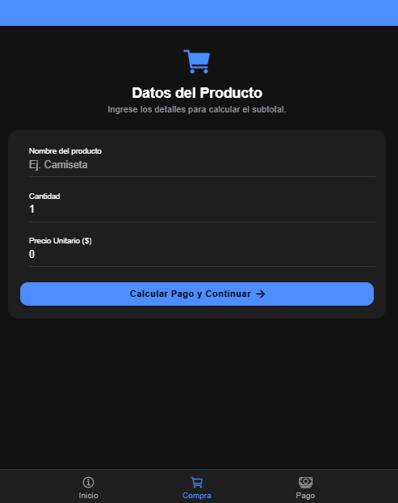
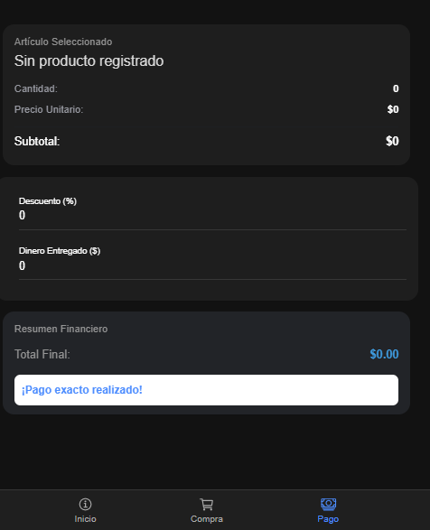
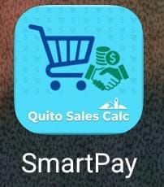
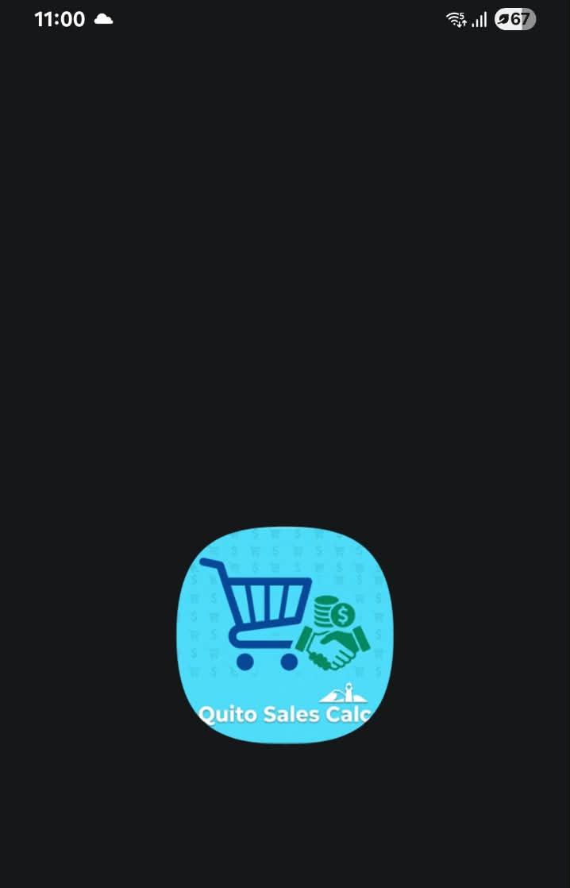

# SmartPay

Aplicación móvil multiplataforma para registrar una compra y calcular de forma sencilla el descuento aplicado, el pago recibido, el cambio que se debe devolver o el saldo que aún queda pendiente. El proyecto está desarrollado con Ionic y Angular Standalone Components, y utiliza Capacitor para su integración con Android.

> Proyecto académico de desarrollo de software. Las cantidades se procesan en el cliente y el estado de la compra se comparte en memoria durante la ejecución.

##  Capturas de la aplicación

Agrega aquí capturas reales de la app en ejecución. Puedes guardar las imágenes en `docs/screenshots/` y reemplazar las rutas de ejemplo.

| Inicio / Información | Compra | Pago |
|---|---|---|
|  |  |  |

##  Funcionalidades

- Registro del nombre del producto, cantidad y precio unitario.
- Cálculo del subtotal de la compra.
- Aplicación de un descuento porcentual, validado entre 0 % y 100 %.
- Registro del dinero recibido y cálculo del total final.
- Presentación del cambio a devolver o del saldo pendiente.
- Validación de datos básicos antes de continuar al cálculo del pago.
- Interfaz basada en componentes de Ionic adaptable a móvil y web.

##  Tecnologías

| Tecnología | Uso |
|---|---|
| Ionic 9+ | Componentes y experiencia de interfaz multiplataforma. |
| Angular | Estructura de la aplicación, componentes y navegación. |
| Angular Standalone Components | Componentes independientes y carga de páginas por rutas. |
| Capacitor 8 | Integración del proyecto web con la plataforma Android. |
| TypeScript | Lógica de negocio y tipado de los datos. |
| HTML5 | Plantillas de las páginas. |
| CSS3 / SCSS | Estilos y personalización visual. |
| RxJS | Comunicación reactiva del estado compartido de compra. |
| Ionicons | Iconografía de la interfaz. |

Las versiones concretas instaladas se encuentran en `package.json` y `package-lock.json`.

##  Arquitectura y navegación

La aplicación usa componentes standalone y Angular Router. Las rutas de las pestañas se definen en `src/app/tabs/tabs.routes.ts`; las páginas se cargan de forma diferida mediante `loadComponent`. La navegación inicial dirige a Inicio/Info.

```text
src/app/
├── app.routes.ts              # Rutas raíz
├── tabs/
│   ├── tabs.page.*            # Contenedor y navegación de pestañas
│   └── tabs.routes.ts         # Rutas hijas de las pestañas
├── info/                      # Inicio / información
├── tab1/                      # Compra
├── tab2/                      # Pago y resultados
└── services/
    └── datos.ts               # DatosService y modelo DatosCompra
```

### Pestañas principales

1. **Compra (Tab 1):** captura nombre, cantidad y precio unitario. Valida los campos, calcula el subtotal a través del servicio y navega a Pago.
2. **Pago (Tab 2):** permite ingresar descuento y dinero recibido. Muestra el total final y determina si corresponde devolver cambio o si queda un saldo pendiente.
3. **Inicio / Info:** pantalla introductoria de la app y punto de entrada de la navegación. En las rutas actuales está implementada como `InfoPage` en `src/app/info/`; las pestañas Compra y Pago corresponden a `tab1` y `tab2`.

### Estado compartido: `DatosService`

`src/app/services/datos.ts` define `DatosService`, disponible mediante `providedIn: 'root'`. El servicio mantiene un `BehaviorSubject<DatosCompra>` con nombre, cantidad, precio unitario y subtotal, y expone `currentCompra` como observable. La pantalla Compra actualiza los datos con `actualizarCompra(...)` y la pantalla Pago se suscribe para recibirlos y recalcular los importes.

El estado es temporal: se conserva mientras la aplicación está abierta, pero no se persiste al cerrar o recargarla.

##  Branding: ícono y Splash Screen

El proyecto incluye `@capacitor/assets` como dependencia de desarrollo. Los recursos fuente incluidos actualmente están en `src/assets/icon.jpeg` y `src/assets/splash.jpeg`. La configuración de Capacitor define `appName: 'SmartPay'` y configura la pantalla Splash nativa con duración de 2 segundos, fondo blanco y sin indicador de carga.

Para generar recursos nativos desde las imágenes fuente, la herramienta permite indicar el directorio con `--assetPath`. Confirma que las imágenes cumplen las dimensiones recomendadas por la herramienta y revisa sus salidas antes de sincronizar Android:

```bash
npx @capacitor/assets generate --assetPath src/assets --android
```

> En el repositorio, la configuración de `capacitor-assets` en `package.json` señala `assets/icon.jpeg` y `assets/splash.jpeg`, mientras que los archivos presentes están en `src/assets/`. El comando anterior especifica explícitamente el directorio actual de los recursos.

### Ícono de la aplicación

Reemplaza el placeholder por una imagen del ícono final (por ejemplo, `docs/branding/app-icon.png`).



### Splash Screen

Reemplaza el placeholder por una captura o imagen del Splash Screen (por ejemplo, `docs/branding/splash-screen.png`).



##  Requisitos previos

- Git.
- Node.js y npm en versiones compatibles con Angular instalado en el proyecto.
- Android Studio con Android SDK para compilar o ejecutar la aplicación en Android.
- Un emulador Android configurado o un dispositivo físico con depuración USB para probar la app nativa.

> `package-lock.json` permite instalar las versiones resueltas del proyecto con `npm ci`. Si se presenta un error de compatibilidad de Node.js, consulta el requisito de versión de Angular correspondiente a la versión instalada en `package.json`.

##  Instalación y ejecución

### 1. Clonar el repositorio

```bash
git clone <URL_DEL_REPOSITORIO>
cd SmartPay
```

Sustituye `<URL_DEL_REPOSITORIO>` por la URL HTTPS o SSH del repositorio en GitHub.

### 2. Instalar dependencias

```bash
npm ci
```

### 3. Ejecutar en modo web

```bash
npm start
```

Abre la dirección local que muestre Angular en la terminal (normalmente `http://localhost:4200`). Para generar la compilación web de producción:

```bash
npm run build
```

### 4. Sincronizar con Android

El repositorio ya incluye el proyecto nativo `android/`. Después de compilar la app web, sincroniza los archivos web y los plugins de Capacitor:

```bash
npm run build
npx cap sync android
```

Para abrir el proyecto en Android Studio:

```bash
npx cap open android
```

Desde Android Studio, selecciona un emulador o dispositivo conectado y ejecuta la aplicación. Cada vez que cambies el código web, vuelve a ejecutar `npm run build` y `npx cap sync android` antes de probar los cambios nativos.

##  Recursos principales

- `src/app/`: páginas, componentes y navegación Angular.
- `src/app/services/datos.ts`: modelo y servicio compartido de compra.
- `src/assets/`: recursos visuales de la aplicación.
- `android/`: proyecto de plataforma Android administrado con Capacitor.
- `capacitor.config.ts`: identificador, nombre y opciones de Capacitor.
- `package.json`: scripts y dependencias del proyecto.

##  Autoría

**Autor:** [Ariel Arias]  
**Perfil:** Estudiante de Desarrollo de Software 
**Institución:** [Escuela Politecnica Nacional]  
**Asignatura:** [Desarrollo de Aplicaciones Moviles]  
**Año:** 2026

SmartPay se desarrolla con fines académicos para aplicar conocimientos de desarrollo móvil, diseño de interfaces, componentes standalone, navegación y gestión de estado compartido.

